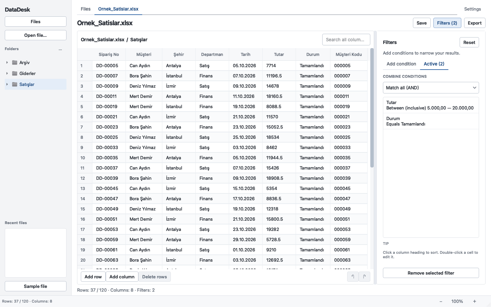
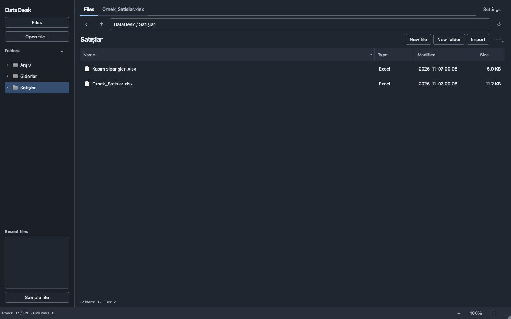

# DataDesk

[Türkçe](README.md) · [English](README.en.md)

DataDesk is a local workspace for people who work with Excel and CSV files. Organize folders, create tables, edit cells, filter records, and export the results. Your files stay on your computer.

[](https://github.com/KrAlmano/DataDesk/actions/workflows/tests.yml)
[](https://github.com/KrAlmano/DataDesk/actions/workflows/desktop-packages.yml)

**[Download DataDesk](https://github.com/KrAlmano/DataDesk/releases/latest)** · [User guide](docs/USAGE.en.md)



## A workspace alongside Excel

DataDesk 1.2.0 uses the same desktop interface on macOS and Windows, with a bundled Inter font, light and dark themes, and English and Turkish controls. Open **Ayarlar** on first launch, choose **English**, then **Uygula** to switch immediately. Language, appearance, and interface size are remembered.

- Create folders and real `.xlsx`, `.csv`, or `.tsv` tables with your own column headings.
- Copy existing files into your working folder, or open a file from another location.
- Edit cells, add rows and columns, delete rows, and undo or redo recent changes.
- Combine text, numeric, date, and empty-cell filters using AND or OR. Search across columns and sort by data type.
- Export every matching row with your chosen column order to Excel, CSV, TSV, or Word.
- Open your saved table in Excel or your computer's default spreadsheet application.
- Use **Settings** to choose **Light**, **Dark**, or **System**, and adjust the interface from 75% to 150%. Changing language preserves your data, filters, and edit history.

The default working folder is **Documents / DataDesk**. Files are ordinary files you can also access through Finder, File Explorer, and Excel. No server upload or account is required.



## Install

Ready-made packages include the runtime. You do not need Python, uv, or Microsoft Excel to use DataDesk.

| Platform | Download | Installation |
| --- | --- | --- |
| macOS 14+, Apple Silicon | [DataDesk 1.2.0 · ARM64 DMG](https://github.com/KrAlmano/DataDesk/releases/download/v1.2.0/DataDesk-1.2.0-macos-arm64.dmg) | Open the DMG and drag DataDesk.app to Applications. |
| macOS 14+, Intel | [DataDesk 1.2.0 · Intel DMG](https://github.com/KrAlmano/DataDesk/releases/download/v1.2.0/DataDesk-1.2.0-macos-x86_64.dmg) | Open the Intel DMG and drag DataDesk.app to Applications. |
| Windows 10 1809+ / Windows 11, x64 | [DataDesk 1.2.0 · Windows installer](https://github.com/KrAlmano/DataDesk/releases/download/v1.2.0/DataDesk-1.2.0-windows-x64-setup.exe) | Run the installer, then open DataDesk from Start. Administrator access is not required. |

Download the matching `.sha256` file to verify the package. These macOS packages do not have an Apple Developer ID signature or notarization; the Windows installer has no publisher certificate. Your operating system may request confirmation on first launch. On macOS, follow the application-specific **System Settings → Privacy & Security → Open Anyway** flow only after checking the download's source. Do not disable system protection.

Save your work and close DataDesk before updating. Replace the application on macOS or run the newer Windows installer. Uninstalling DataDesk leaves your working folder and spreadsheets in place. Detailed Turkish installation/build guides: [macOS](docs/MACOS.md) · [Windows](docs/WINDOWS.md).

## First steps

1. Open **Settings**, choose your language, theme, and interface size, then **Apply**.
2. Use **New folder**, then **New file** to create a table; or **Import** to copy an existing spreadsheet into that folder.
3. Open the file and check its sheet, header row, or CSV encoding and delimiter in the preview.
4. Edit cells or add rows, then **Save** your working table.
5. Open **Filters**, add a condition, and use **Export** to write the matching rows to a separate file.

[The user guide](docs/USAGE.en.md) explains the complete workflow, number formats, settings, and shortcuts.

## Save and export

| Action | What is written |
| --- | --- |
| **Save** | All rows and columns in the working table, including records currently hidden by filters. Direct save is available for unchanged DataDesk-created files. |
| **Save as** | The complete working table as a new Excel, CSV, or TSV file. |
| **Export** | The current search/filter/sort result and the selected columns as a separate file. |

Saving an external workbook asks for a new file so its other sheets and workbook features are preserved. If another application has changed a DataDesk-created file, DataDesk also asks for a new destination.

## File support and limits

Read `.xlsx`, `.xlsm`, `.xls`, `.csv`, and `.tsv`; export `.xlsx`, `.csv`, `.tsv`, and `.docx`. Choose the Excel sheet and header row, or the CSV delimiter and encoding, before opening. Missing and duplicate headings receive unique names. Leading zeroes in text IDs and literal strings such as `NA` and `null` are preserved.

Number filtering supports Turkish `1.234,56` and English `1,234.56` formats. In **Automatic** mode, a single comma or dot is a decimal separator; choose **Turkish** or **English** explicitly for ambiguous thousands separators. Interface language does not change these parsing rules or your source cells.

CSV exports default to UTF-8 BOM and semicolons. Optional **CSV formula protection** prefixes text that looks like a formula with an apostrophe. **Save / Save as** preserves raw CSV/TSV cell text without that prefix. Excel may infer different types when opening CSV; prefer `.xlsx` when text IDs or codes must remain text.

DataDesk works with data tables. It does not calculate Excel formulas or recreate a workbook's macros, charts, images, merged cells, or original formatting. It reads saved formula results; formulas without a saved result are shown as text with a warning. Recalculate and save in Excel or LibreOffice when fresh results are required. Tables load into memory, so practical file size depends on available RAM and format limits.

## Run from source

Python 3.11–3.14 is supported; desktop packages use Python 3.12. With [uv](https://docs.astral.sh/uv/):

```bash
git clone https://github.com/KrAlmano/DataDesk.git
cd DataDesk
uv run datadesk
```

Or create a virtual environment and install with `python -m pip install -e .`, then run `python -m datadesk`.

## Development checks and packages

```bash
uv sync --extra dev
uv run --extra dev ruff check .
uv run --extra dev ruff format --check .
QT_QPA_PLATFORM=offscreen uv run --extra dev pytest -q
```

In PowerShell, set `$env:QT_QPA_PLATFORM = "offscreen"` before running pytest. Tests use real temporary spreadsheets and Qt widgets. Current results are available in [Tests](https://github.com/KrAlmano/DataDesk/actions/workflows/tests.yml).

Build on the target platform: `bash packaging/macos/build.sh` on macOS after `uv sync --extra build`, or `pwsh -File packaging/windows/Build-Installer.ps1` on Windows with uv and Inno Setup 6.4+. Packages appear in `dist/installers/`. [Desktop packages](https://github.com/KrAlmano/DataDesk/actions/workflows/desktop-packages.yml) builds and verifies Apple Silicon, Intel, and Windows packages separately.

## License

DataDesk: [MIT](LICENSE). Inter: [SIL Open Font License](datadesk/assets/fonts/OFL.txt). [Third-party notices](packaging/THIRD_PARTY_NOTICES.txt).
