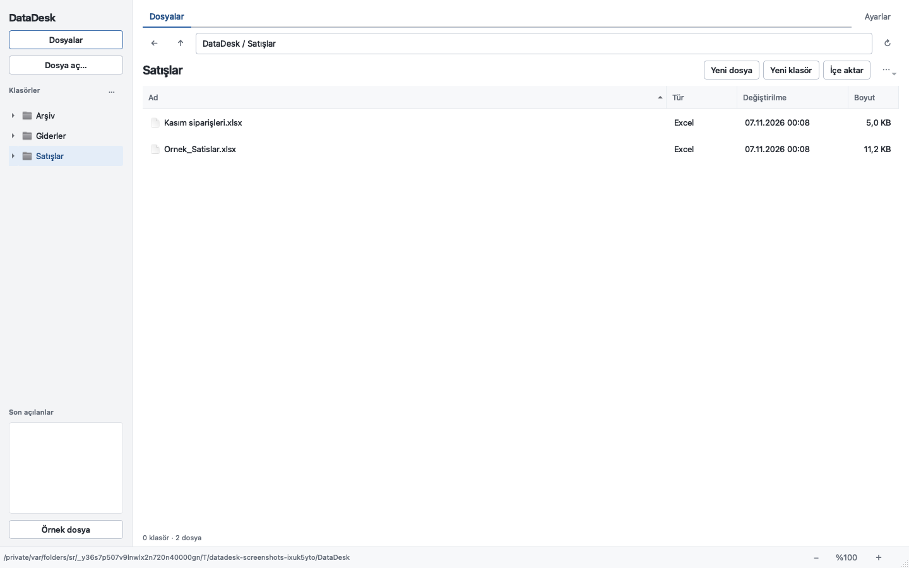
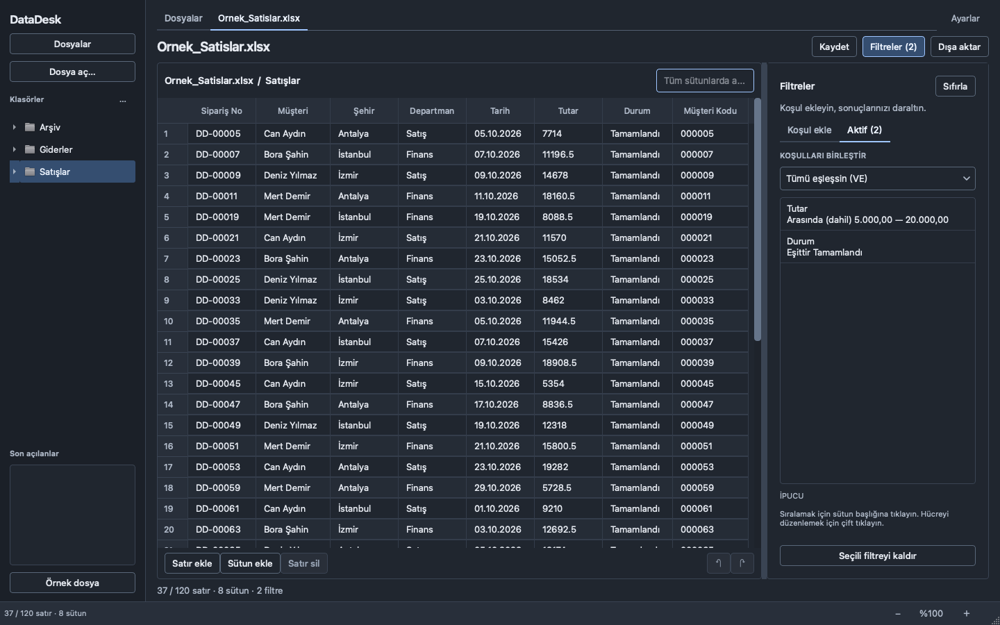

# DataDesk

[Türkçe](README.md) · [English](README.en.md)

DataDesk, Excel ve CSV ile çalışanlar için yerel bir dosya ve tablo çalışma alanıdır. Klasör oluşturun, yeni bir tablo açın, dosyalarınızı düzenleyin; gerektiğinde filtreleyip ayrı bir çıktı alın.

[](https://github.com/KrAlmano/DataDesk/actions/workflows/tests.yml)
[](https://github.com/KrAlmano/DataDesk/actions/workflows/desktop-packages.yml)

**[Uygulamayı indir](https://github.com/KrAlmano/DataDesk/releases/latest)** · [Kullanım kılavuzu](docs/KULLANIM.md) · [macOS kurulumu](docs/MACOS.md) · [Windows kurulumu](docs/WINDOWS.md)



## Çalışma alanı

DataDesk 1.2.0 dosya ve klasörlerle başlar. Solda klasörler, **Dosyalar** sekmesinde o klasörün içeriği bulunur. Açılan tablo ayrı bir sekmede gösterilir; filtre paneli ihtiyaç duyduğunuzda açılır. macOS ve Windows aynı sade arayüzü ve gömülü Inter yazı tipini kullanır.

- **Klasörler:** Alt klasör oluşturma, yeniden adlandırma ve çalışma alanının içinde taşıma.
- **Yeni dosya:** Adını, biçimini ve sütun adlarını belirleyerek gerçek `.xlsx`, `.csv` veya `.tsv` dosyası oluşturma.
- **Mevcut dosyalar:** **İçe aktar** ile dosyanın bir kopyasını çalışma klasörüne ekleme; **Dosya aç** ile başka bir konumdaki dosyayı açma. Aynı adlı dosyanın üzerine yazılmaz.
- **Tablo düzenleme:** Hücre düzenleme, satır/sütun ekleme, satır silme ve son düzenlemeleri geri alma/yineleme.
- **Filtre ve arama:** Metin, sayı, tarih, boş/dolu koşulları; birden çok koşulu VE/VEYA ile birleştirme; bütün tabloda arama ve türüne göre sıralama.
- **Çıktı:** Filtre sonucunun tüm satırlarını, seçilen sütun ve sırayla Excel, CSV, TSV veya Word'e aktarma.
- **Excel ile birlikte kullanma:** Dosyayı bilgisayarınızdaki Excel veya varsayılan tablo uygulamasında açma.
- **Görünüm ve dil:** Açık, koyu veya sistem teması; Türkçe/İngilizce arayüz; %75–150 arayüz boyutu. Tercihler anında uygulanır ve sonraki açılışta hatırlanır.

Çalışma klasörü varsayılan olarak **Belgeler / DataDesk** konumundadır; başka bir klasör seçebilirsiniz. Bunlar diskteki normal dosya ve klasörlerdir: DataDesk kapalıyken de Finder/Explorer ve Excel'den kullanılabilir. Dosyalar bir sunucuya yüklenmez.

### Kaydet ve dışa aktar

| İşlem | Kaydedilen veri | Hedef |
| --- | --- | --- |
| **Kaydet** | Düzenlemelerle birlikte çalışma tablosunun **tüm satırları ve sütunları**; filtre gizlediği kayıtları silmez. | DataDesk'te oluşturulan ve dışarıdan değiştirilmemiş tek tabloluk dosyanın kendisi. |
| **Farklı kaydet** | Çalışma tablosunun tamamı. | Yeni bir Excel, CSV veya TSV dosyası. |
| **Dışa aktar** | Geçerli arama/filtre/sıralama sonucu ve seçtiğiniz sütunlar. | Ayrı bir çıktı dosyası. |

Dışarıdan açılan dosyalarda **Kaydet**, yeni dosya oluşturma akışına yönlendirir. Kaynak çalışma kitabının diğer sayfalarını, formüllerini veya biçimlerini bir tablo kaydıyla değiştirmez. DataDesk dosyanızı Excel gibi başka bir uygulamada değiştirdiğinizi fark ederse aynı dosyanın üzerine kaydetmez; yeni bir ad ister.

### Açık/koyu tema ve İngilizce arayüz

Üstteki **Ayarlar** düğmesinden tema, dil ve arayüz boyutunu seçip **Uygula** düğmesine basın. **Sistem**, işletim sisteminin açık/koyu görünümünü izler. Dil değiştirirken açık tablo, hücre içerikleri, sütun adları, filtreler ve düzenleme geçmişi korunur; yalnızca arayüz metinleri değişir. `Cmd+,` (macOS) veya `Ctrl+,` (Windows) ile ayarları açabilirsiniz.



[İngilizce arayüz](docs/screenshots/11-english.png) · [Ayarlar penceresi](docs/screenshots/12-settings.png) · [Koyu çalışma alanı](docs/screenshots/13-workspace-dark.png)

## Kurulum

[GitHub Releases](https://github.com/KrAlmano/DataDesk/releases/latest) sayfasından işletim sisteminize uygun paketi indirin. Hazır paket için **Python, uv veya Microsoft Excel kurulumu gerekmez**.

| Sistem | Paket | Kurulum |
| --- | --- | --- |
| macOS 14+, Apple Silicon (M serisi) | [DataDesk 1.2.0 · ARM64 DMG](https://github.com/KrAlmano/DataDesk/releases/download/v1.2.0/DataDesk-1.2.0-macos-arm64.dmg) | DataDesk.app'i Applications klasörüne sürükleyin. |
| macOS 14+, Intel | [DataDesk 1.2.0 · Intel DMG](https://github.com/KrAlmano/DataDesk/releases/download/v1.2.0/DataDesk-1.2.0-macos-x86_64.dmg) | Intel paketindeki DataDesk.app'i Applications'a sürükleyin. |
| Windows 10 1809+ / Windows 11, x64 | [DataDesk 1.2.0 · Windows kurucusu](https://github.com/KrAlmano/DataDesk/releases/download/v1.2.0/DataDesk-1.2.0-windows-x64-setup.exe) | Kurucuyu çalıştırın; Başlat menüsünden DataDesk'i açın. Yönetici yetkisi gerekmez. |

Paketlerle birlikte SHA-256 doğrulama dosyaları yayımlanır. macOS paketleri Apple Developer ID ile imzalanmış/noter onaylı değildir; Windows kurucusunda yayıncı sertifikası yoktur. İlk açılışta işletim sistemi onayı gerekebilir. Ayrıntılar: [macOS](docs/MACOS.md) · [Windows](docs/WINDOWS.md).

## İlk çalışma

1. **Yeni klasör** ile örneğin `Satışlar` klasörünü oluşturup açın.
2. **Yeni dosya** ile `Kasım.xlsx` oluşturun; sütun adlarını `Kod`, `Müşteri`, `Tutar` olarak belirleyin. Elinizde veri varsa **İçe aktar** ile bir kopyasını bu klasöre ekleyin.
3. Dosyayı açın. Hücreleri düzenleyin, satır ekleyin ve **Kaydet** ile çalışma tablosunu kaydedin.
4. **Filtreler** düğmesini açıp bir koşul ekleyin; örneğin `Tutar > 1000`.
5. **Dışa aktar** ile raporda yer alacak sütunları ve dosya biçimini seçin.

[Adım adım kılavuz ve gerçek uygulama görüntüleri](docs/KULLANIM.md).

## Dosya ve veri desteği

Giriş: `.xlsx`, `.xlsm`, `.xls`, `.csv`, `.tsv`. Excel sayfası ve başlık satırı; CSV ayıracı ve kodlaması önizlemede seçilir. Eksik/tekrarlanan sütun başlıklarına benzersiz ad verilir. Metin kimliklerindeki baştaki sıfırlar ile `NA` ve `null` gibi gerçek metinler korunur.

Türkçe `1.234,56` ve uluslararası `1,234.56` sayılar; gerçek Excel tarihleri ve açık tarih metinleriyle filtreleme desteklenir. **Otomatik** sayı biçiminde tek nokta/virgül ondalık ayracıdır. `1.234` ile bin iki yüz otuz dört demek istiyorsanız **Türkçe** biçimi seçin. Tür ve sayı biçimi seçimleri karşılaştırmayı belirler; kaynak hücreleri dönüştürmez.

Varsayılan CSV çıktısı UTF-8 BOM ve noktalı virgül kullanır. **CSV formül güvenliği**, **Dışa aktar** işleminde formül gibi yorumlanabilecek metinlere tek tırnak öneki ekler; ham metin gerekiyorsa kapatılabilir. **Kaydet / Farklı kaydet** ise CSV/TSV çalışma dosyasına ham hücre metinlerini bu öneki eklemeden yazar. Excel CSV açarken metinleri sayı, tarih veya formül olarak yorumlayabilir; kimlik/kod ve metin türlerini taşımak için `.xlsx` tercih edin.

### Kapsam ve sınırlar

- DataDesk bir Excel formül ve biçim düzenleyicisi değildir. Yeni kayıtlar/çıktılar veri tablosudur; kaynak çalışma kitabının grafiklerini, resimlerini, birleşik hücrelerini, özgün biçimlerini ve makrolarını yeniden üretmez.
- Formüller hesaplanmaz. Excel'in son kaydettiği hesaplanmış sonuç okunur; sonucu bulunmayan formül uyarıyla metin olarak gösterilir. Güncel sonuç için dosyayı Excel/LibreOffice'te hesaplatıp kaydedin.
- Tablolar belleğe yüklenir. İşlenebilecek dosya boyutu bilgisayarın belleğine ve Excel biçiminin sınırlarına bağlıdır.
- CSV kodlaması her dosyada kesin tahmin edilemez. Türkçe karakterler bozuksa kodlamayı önizlemede elle seçin.
- Eski uygulamanın masaüstündeki `Veri Düzenleyici VeriTabanı` klasörü otomatik taşınmaz. Dosyalarını açabilir veya yeni çalışma alanına kopyalayabilirsiniz.

## Kaynak koddan çalıştırma

Python **3.11–3.14** desteklenir; kurulum paketleri Python 3.12 ile üretilir.

[uv](https://docs.astral.sh/uv/) ile:

```bash
git clone https://github.com/KrAlmano/DataDesk.git
cd DataDesk
uv run datadesk
```

`pip` ile:

```bash
python3.12 -m venv .venv
```

macOS / Linux:

```bash
source .venv/bin/activate
python -m pip install -e .
python -m datadesk
```

Windows PowerShell:

```powershell
py -3.12 -m venv .venv
.venv\Scripts\Activate.ps1
python -m pip install -e .
python -m datadesk
```

`datadesk`, `python main.py` ve eski `python Excel_project/main.py` girişleri aynı uygulamayı açar.

## Test ve paketleme

```bash
uv sync --extra dev
uv run --extra dev ruff check .
uv run --extra dev ruff format --check .
QT_QPA_PLATFORM=offscreen uv run --extra dev pytest -q
```

PowerShell'de testten önce `$env:QT_QPA_PLATFORM = "offscreen"` ayarlayın. Testler geçici klasörlerde gerçek Excel/CSV dosyaları oluşturup yeniden açar; filtre sonuçlarını, kaynak verinin korunmasını, dosya işlemlerini ve Qt arayüzünü denetler. Güncel sonuçlar [Testler](https://github.com/KrAlmano/DataDesk/actions/workflows/tests.yml) iş akışındadır. Kapsam ve tekrar adımları: [teknik notlar](docs/TEKNIK_INCELEME.md).

macOS'ta paket üretme:

```bash
uv sync --extra build
bash packaging/macos/build.sh
```

Windows'ta uv ve Inno Setup 6.4+ ile:

```powershell
pwsh -File packaging/windows/Build-Installer.ps1
```

Kurucular `dist/installers/` altındadır. [Desktop packages](https://github.com/KrAlmano/DataDesk/actions/workflows/desktop-packages.yml), Apple Silicon, Intel ve Windows paketlerini kendi hedeflerinde üretir; Windows'ta gerçek kurulum/kaldırma ve macOS'ta DMG'den kopyalanan uygulama test edilir. Kaldırma işlemi çalışma klasörünüzü ve tablolarınızı silmez.

## Lisans

DataDesk: [MIT](LICENSE). Inter: [SIL Open Font License](datadesk/assets/fonts/OFL.txt). [Dağıtım bileşenlerinin lisans notları](packaging/THIRD_PARTY_NOTICES.txt).
