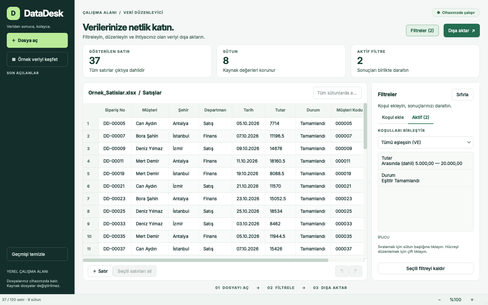

# DataDesk

Excel ve CSV dosyalarını açın, birkaç adımda filtreleyin ve ihtiyacınız olan sütunlarla temiz çıktılar alın. DataDesk, Türkçe arayüzü olan ve dosyalarınızı bilgisayarınızda işleyen bir masaüstü uygulamasıdır.

[](https://github.com/KrAlmano/DataDesk/actions/workflows/tests.yml)
[](https://github.com/KrAlmano/DataDesk/actions/workflows/desktop-packages.yml)

**[Uygulamayı indir](https://github.com/KrAlmano/DataDesk/releases/latest)** · **[Görsellerle kullanım kılavuzu](docs/KULLANIM.md)** · [macOS kurulumu](docs/MACOS.md) · [Windows kurulumu](docs/WINDOWS.md)

[](docs/screenshots/04-results.png)

1. İşletim sisteminize uygun kurucuyu indirip DataDesk'i açın. Python veya Excel gerekmez.
2. Dosyanızı seçin, sayfa ve sütunları önizlemede kontrol edin; filtrelerinizi ekleyin.
3. Sonucu, seçtiğiniz sütunlarla Excel veya CSV olarak kaydedin.

Ekranlar gerçek uygulamadan alınmıştır; gösterilen satış kayıtları yapay örnek veridir.

## Neler yapabilirsiniz?

- **Excel ve CSV açma:** `.xlsx`, `.xlsm`, `.xls`, `.csv` ve `.tsv`; Excel sayfasını, başlık satırını, CSV ayıracını ve karakter kodlamasını seçme.
- **Sütunları koruma:** Eksik ve tekrarlanan başlıklara benzersiz adlar verme; başlığı eksik diye ilk veri satırını silmeme; metin olarak saklanan `00123`, `NA` ve `null` değerlerini koruma.
- **Sayı, tarih ve metin filtreleri:** İçerir/içermez, tam eşleşme, başlangıç/bitiş, aralık, karşılaştırma ve boş/dolu koşulları; tüm kelimeler veya herhangi bir kelimeyle arama.
- **Birden çok koşul:** Filtreleri **tümü eşleşsin (VE)** veya **herhangi biri eşleşsin (VEYA)** ile birleştirme; bütün tabloda arama yapma.
- **Sıralama ve düzenleme:** Sütun tipine göre sıralama, satır ekleme/silme ve hücre düzenleme; düzenlemeleri geri alma ve yineleme.
- **İstediğiniz çıktıyı alma:** Görünen sonucun tüm satırlarını ve seçtiğiniz sütunları Excel, CSV, TSV veya Word olarak dışa aktarma. Sıfır sonuçta da sütun başlıklarını içeren dosya oluşturma.
- **Büyük tablolarla çalışma:** Ekrandaki hücreleri gerektiğinde çizen Qt tablo modeli; dosya okuma, filtreleme ve çıktı işlemleri için arka plan görevleri.
- **Ekrana uyum sağlayan görünüm:** Dar pencerede otomatik küçülen yan menü ve tablo/filtre geçişi; geniş ekranda boyutu ayarlanabilen ve gizlenebilen filtre paneli. Kısa pencerelerde özet alanı sadeleşir, tabloya yer kalır.
- **Okunabilir arayüz:** Görünüm menüsü veya alt çubuktan %75–150 arayüz büyüklüğü; büyüklük tercihi hatırlanır. Filtre ve dosya işlem düğmeleri sabit kalır, uzun formlar ve uyarılar kaydırılır. Yüksek çözünürlüklü ekranlarda Qt'nin DPI desteği kullanılır.

Kaynak dosyanız doğrudan düzenlenmez. Değişiklikler çalışma belleğinde tutulur; sonucu ayrı bir dosyaya dışa aktarın. Dosyalarınız bir sunucuya yüklenmez.

## Kurulum ve çalıştırma

### Hazır uygulama: macOS ve Windows

İki paket aynı DataDesk arayüzünü, Inter yazı tipini ve veri motorunu kullanır. Hazır kurulumda **Python, uv veya Microsoft Excel gerekmez**.

| Sistem | Kurulum dosyası | Kurulum |
| --- | --- | --- |
| macOS 14+, Apple Silicon (M serisi) | [Mac M serisi kurucusu](https://github.com/KrAlmano/DataDesk/releases/download/v1.0.0/DataDesk-1.0.0-macos-arm64.dmg) | DataDesk.app simgesini Applications klasörüne sürükleyin. |
| macOS 14+, Intel | [Mac Intel kurucusu](https://github.com/KrAlmano/DataDesk/releases/download/v1.0.0/DataDesk-1.0.0-macos-x86_64.dmg) | Intel paketini açıp DataDesk.app'i Applications'a sürükleyin. |
| Windows 10 1809+ / Windows 11, x64 | [Windows kurucusu](https://github.com/KrAlmano/DataDesk/releases/download/v1.0.0/DataDesk-1.0.0-windows-x64-setup.exe) | Kurucuyu çalıştırın; Başlat menüsünden DataDesk'i açın. Yönetici yetkisi gerekmez. |

Kalıcı indirmeler [GitHub Releases](https://github.com/KrAlmano/DataDesk/releases/latest) sayfasındadır. Paketlerin yanında SHA-256 özetleri bulunur. Apple Silicon, Intel ve Windows derlemeleri kendi işletim sistemi/mimarilerinde üretilip test edilir. Geliştirme derlemeleri ve test raporları ayrıca [Desktop packages](https://github.com/KrAlmano/DataDesk/actions/workflows/desktop-packages.yml) iş akışının **Artifacts** bölümünde tutulur.

Kurulum, güncelleme, kaldırma ve ilk açılış ayrıntıları: [macOS](docs/MACOS.md) · [Windows](docs/WINDOWS.md). Mevcut geliştirme paketlerinde Apple Developer ID/noter onayı veya Windows yayıncı sertifikası sağlanmamıştır; ilk açılışta işletim sistemi onayı gerekebilir. İmzalama altyapısı macOS betiğinde isteğe bağlıdır.

### Kaynak koddan çalıştırma: uv

Geliştirme için Python **3.11–3.14** desteklenir; paketler Python 3.12 ile üretilir.

[uv](https://docs.astral.sh/uv/) kuruluysa:

```bash
git clone https://github.com/KrAlmano/DataDesk.git
cd DataDesk
uv run datadesk
```

`uv`, proje için gereken Python ortamını ve bağımlılıkları hazırlar.

### Kaynak koddan çalıştırma: pip

```bash
git clone https://github.com/KrAlmano/DataDesk.git
cd DataDesk
python3.12 -m venv .venv
```

macOS / Linux:

```bash
source .venv/bin/activate
python -m pip install -e .
python -m datadesk
```

Windows PowerShell:

```powershell
.venv\Scripts\Activate.ps1
python -m pip install -e .
python -m datadesk
```

Windows'ta sanal ortamı `py -3.12 -m venv .venv` ile de oluşturabilirsiniz. Kurulumdan sonra `datadesk`, `python main.py` ve eski `python Excel_project/main.py` girişleri aynı uygulamayı açar.

### Yerel kurulum paketi üretme

macOS üzerinde:

```bash
uv sync --extra build
bash packaging/macos/build.sh
```

Windows üzerinde, uv ve Inno Setup 6.4+ kurulu iken:

```powershell
pwsh -File packaging/windows/Build-Installer.ps1
```

Çıktılar `dist/installers/` altındadır. Her derleme gömülü Python/Qt çalışma ortamını taşır. Kullanıcı dosyaları uygulama kurulumunun içine alınmaz; kaldırma işlemi kaynak tabloları ve dışa aktarılan dosyaları silmez.

## İlk dosyanızı filtreleyin

1. **Dosya aç** ile bir Excel veya CSV seçin. İçeri aktarma ayarlarında doğru sayfayı, başlık satırını ve gerekirse ayraç/kodlamayı seçin.
2. Bir sütun ve koşul seçip filtreyi ekleyin. Örneğin `Tutar` sütununda `1.000,50` ile `5.000,00` aralığını kullanın.
3. İkinci koşulu ekleyin. `Şehir = İstanbul` ve tutar koşulunun birlikte sağlanması için **tümü**, ikisinden birinin yeterli olması için **herhangi biri** seçeneğini kullanın.
4. Sonuç sayısını ve tablodaki değerleri kontrol edin. Sütun başlığıyla sıralayın; gerektiğinde filtreleri tek tek kaldırın.
5. **Dışa aktar** ile formatı, sütunları ve kayıt konumunu seçin. Çıktı yalnızca ekrandaki birkaç satırı değil, filtre sonucunun tamamını içerir.

Küçük pencerede **Filtreler** düğmesi filtre görünümünü açar; **Tabloya dön** ile sonuçlara geçilir. Geçerli bir filtre eklediğinizde sonuç tablosu kendiliğinden açılır. **Görünüm → Filtreleri göster/gizle** kısayolu `Ctrl/Cmd+Shift+F`; büyütme/küçültme `Ctrl/Cmd++` ve `Ctrl/Cmd+−`, varsayılan büyüklük `Ctrl/Cmd+0`.

[800×600 dar görünüm](docs/screenshot-compact.png) · [Sabit filtre düğmesi](docs/screenshot-compact-filters.png) · [%150 arayüz büyüklüğü](docs/screenshot-zoom.png)

## Veri okuma ve çıktı davranışı

| Konu | Davranış |
| --- | --- |
| Sayılar | Türkçe `1.234,56` ve uluslararası `1,234.56` biçimleriyle filtreleme; karşılaştırma için yapılan dönüşüm kaynak hücreyi değiştirmez. |
| Tarihler | Gerçek Excel tarihleri ve açık tarih biçimleriyle filtreleme. Tarih aralığının başlangıç ve bitiş günleri dahildir. |
| Kodlar / kimlikler | Metin olarak saklanan baştaki sıfırlar korunur. CSV'nin veri tipi bilgisi yoktur; kimlikleri Excel'e güvenilir biçimde taşımak için `.xlsx` çıktısı kullanın. |
| Başlıklar | Başlık satırı açıkça seçilir; başlıksız tablolar da açılabilir. Eksik ve tekrarlı adlar benzersiz hale getirilir. |
| Boş değerler | Gerçek boş hücreler ile `NA`, `null` gibi metinler ayrı tutulur. |
| CSV | Otomatik ayraç/kodlama algılaması ve elle seçim. Varsayılan çıktı Excel'le uyumlu UTF-8 BOM ve noktalı virgül kullanır. |
| Excel çıktısı | Başlık biçimi, filtre ve sabit başlık satırı; sayı/tarih hücrelerinin yerel tiplerini koruyan yeni çalışma kitabı. |
| CSV formül güvenliği | Varsayılan güvenli çıktı, formül gibi yorumlanabilecek metinlere tek tırnak öneki ekler. Ham metin aktarımı gerekiyorsa bu seçenek kapatılabilir. |

Sütun tipi algılama temkinlidir. Karışık veya anlamı belirsiz bir sütunda filtre için türü kendiniz seçin. Tarihlerde gün/ay/yıl ve ISO yıl/ay/gün biçimleri kullanılır; `03/04/2026` gün/ay/yıl olarak yorumlanır.

Sayı biçiminde **Otomatik** seçiliyken tek ayraçlı `1.234` ve `1,234` değerleri **1,234 ondalık değeri** olarak yorumlanır. Binlik ayracını açıkça belirtmek için **Türkçe** veya **İngilizce** sayı biçimini seçin: Türkçe biçimde `1.234`, İngilizce biçimde `1,234` bin iki yüz otuz dörttür. Otomatik biçimde iki ayraç birlikteyse sonuncusu ondalık ayraçtır; `1.234,56` ile `1,234.56` aynı sayıdır. Bu seçim karşılaştırmayı ve sıralamayı belirler; kaynak metinleri yeniden yazmaz.

## Sınırlar

- DataDesk bir Excel hesaplama motoru değildir. Formüllerde Excel'in en son kaydettiği hesaplanmış değer kullanılır; önbellek değeri olmayan formüller görünür metin olarak tutulur ve uyarı verilir. Böyle bir dosyayı Excel/LibreOffice'te hesaplatıp kaydedin ve yeniden açın.
- Makrolar çalıştırılmaz ve yeni çıktıya taşınmaz. Kaynak dosyanın grafikleri, resimleri, birleşik hücreleri ve özgün biçimlendirmesi yeniden üretilmez; çıktı bir veri tablosudur.
- CSV kodlamasını her dosyada kesin olarak tahmin etmek mümkün değildir. Türkçe karakterler beklediğiniz gibi görünmüyorsa kodlamayı elle seçerek tekrar açın.
- Tablolar belleğe yüklenir; işlenebilecek dosya boyutu bilgisayarın belleğine bağlıdır. Excel'in satır/sütun sınırları geçerlidir. Çok geniş tablolar için Word yerine Excel/CSV tercih edin.
- Eski sürümün masaüstünde oluşturduğu `Veri Düzenleyici VeriTabanı` klasörü taşınmaz veya silinmez. İçindeki dosyaları **Dosya aç** ile doğrudan seçebilirsiniz.

## Geliştirme ve testler

```bash
uv sync --extra dev
uv run --extra dev ruff check .
QT_QPA_PLATFORM=offscreen uv run --extra dev pytest -q
```

`uv` olmadan:

```bash
python -m pip install -e '.[dev]'
python -m ruff check .
QT_QPA_PLATFORM=offscreen python -m pytest -q
```

PowerShell'de testten önce `$env:QT_QPA_PLATFORM = "offscreen"` kullanın. Ekran açıkken test etmek için bu değişkeni kaldırabilirsiniz. GitHub Actions Linux üzerinde Python 3.11–3.14 testlerini; ayrıca macOS Apple Silicon, macOS Intel ve Windows x64 üzerinde kaynak testlerini, yerel derlemeyi ve kurulu uygulama doğrulamasını çalıştırır. Windows'ta gerçek kurulum/kaldırma; macOS'ta DMG'den geçici klasöre kopyalama test edilir.

Testler geçici dizinlerde ürettikleri gerçek Excel/CSV dosyalarını yeniden açarak veri, sütun sırası ve filtre sonuçlarını denetler. Arayüz testleri Qt olay döngüsüyle çalışır. İnceleme notları ve elle kontrol senaryoları: [Teknik inceleme](docs/TEKNIK_INCELEME.md).

100.000 satırlık dosya akışını ayrıca doğrulamak için `uv run python tools/benchmark.py` çalıştırın. Araç bağımsız beklenen sonuçlarla karşılaştırma yapar, geçici dosyalarını temizler ve bu bilgisayardaki işlem sürelerini raporlar.

```text
datadesk/
├── app.py          # Uygulama girişi
├── ui.py           # Ana pencere ve kullanıcı akışları
├── dialogs.py      # İçe/dışa aktarma ayarları
├── models.py       # Qt tablo modeli ve çalışma belgesi
├── theme.py        # Arayüz teması
├── widgets.py      # Uzun bildirimler, erişilebilir kaydırma ve başlıklar
├── platforms.py    # Mac/Windows başlatma, kısayol ve sistem klasörleri
├── smoke.py        # Kurulu uygulamanın gerçek dosyalarla kabul testi
├── core.py         # Tip algılama, filtreleme ve sıralama
└── io.py           # Dosya okuma ve atomik dışa aktarma
tests/              # Veri motoru, dosya ve arayüz testleri
docs/               # İnceleme notları
packaging/          # Ortak paketleyici, ayrı macOS/Windows kurucuları
Excel_project/main.py  # Eski çalıştırma yoluna uyumluluk
```

## Lisans

DataDesk: [MIT](LICENSE). Gömülü Inter yazı tipi: [SIL Open Font License](datadesk/assets/fonts/OFL.txt). Dağıtım içindeki bağımsız bileşenlerin kendi lisansları geçerlidir: [bileşen notları](packaging/THIRD_PARTY_NOTICES.txt).
