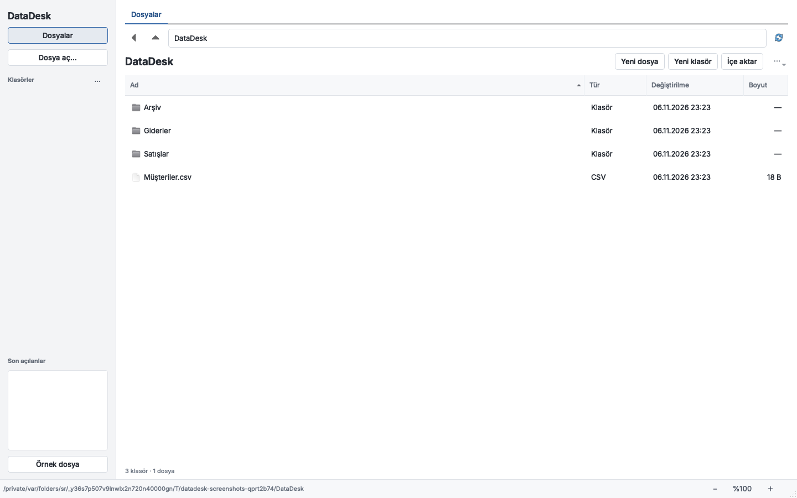
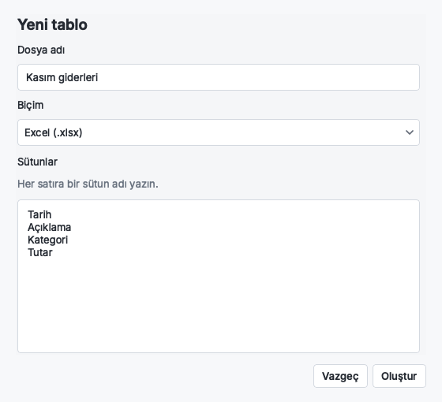
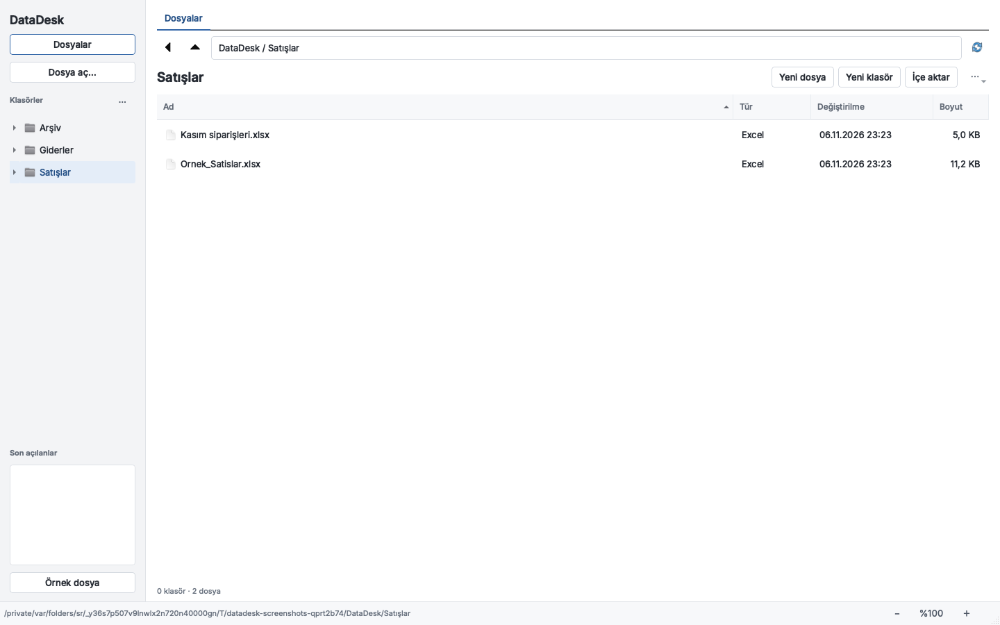
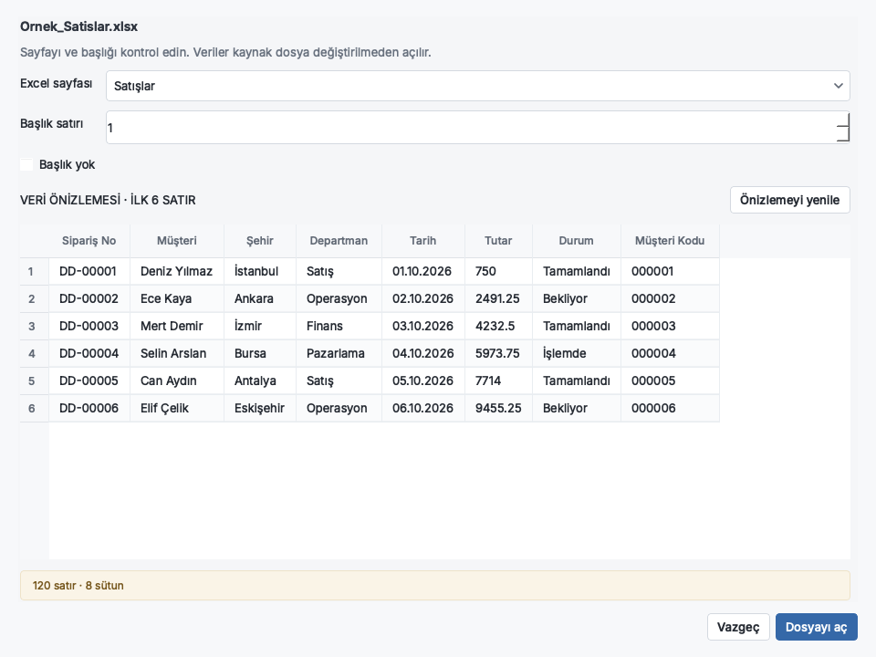
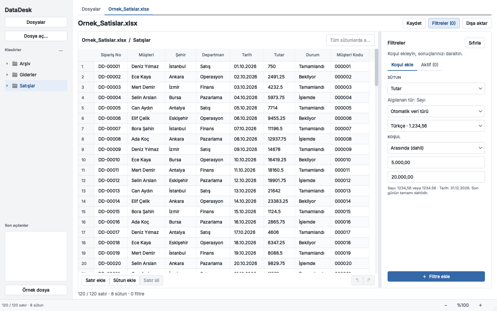
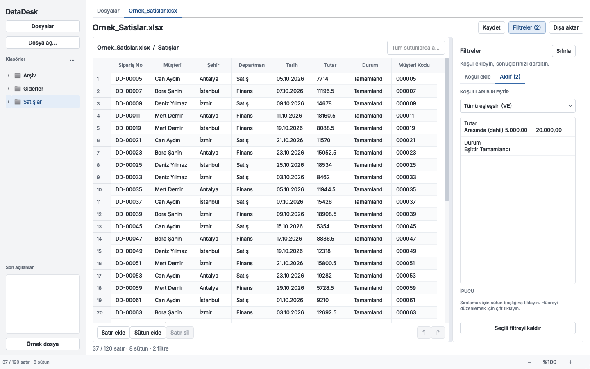
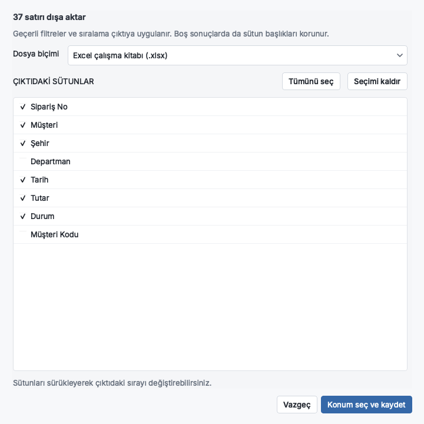
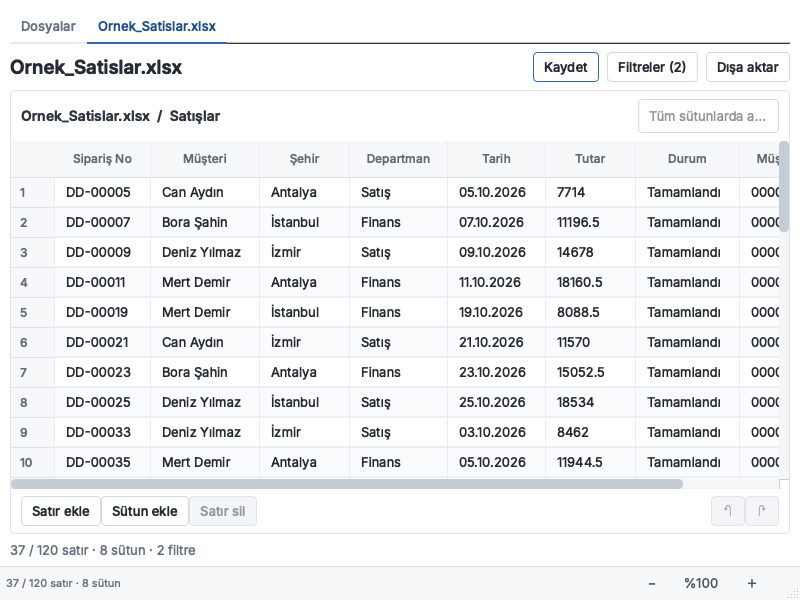
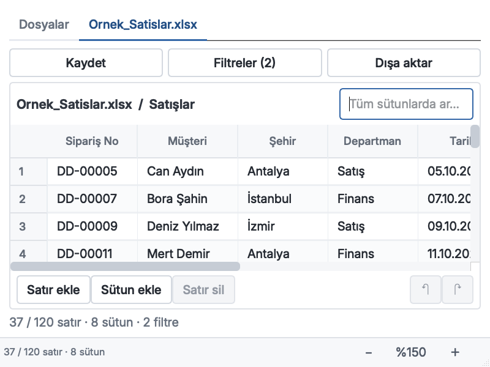

# DataDesk kullanım kılavuzu

DataDesk 1.1.0'da dosyalarınızı klasörler halinde düzenleyebilir, yeni tablolar oluşturabilir ve Excel/CSV verilerinden filtrelenmiş çıktılar alabilirsiniz. Dosyalar bilgisayarınızda kalır. macOS ve Windows aynı arayüzü kullanır; kısayollarda macOS'ta **Cmd**, Windows'ta **Ctrl** geçerlidir.

[Kurulum paketini indirin](https://github.com/KrAlmano/DataDesk/releases/latest). Kurulum adımları: [macOS](MACOS.md) · [Windows](WINDOWS.md). Hazır uygulama için Python veya Excel gerekmez.

## 1. Çalışma klasörünüzü düzenleyin

Başlangıçta **Dosyalar** sekmesi açılır. Varsayılan çalışma klasörü **Belgeler / DataDesk** konumudur. Başka bir konum kullanmak için **Dosya → Çalışma klasörünü değiştir** seçeneğini açın. Seçilen çalışma klasörü ve bulunduğunuz alt klasör sonraki açılışta hatırlanır.

- **Yeni klasör** ile örneğin `Satışlar` oluşturun. Klasöre çift tıklayarak veya soldaki klasör ağacından seçerek girin.
- Üstteki geri/üst klasör düğmeleriyle gezin; yol alanından bulunduğunuz konumu kontrol edin.
- Bir dosya veya klasör seçip sağ tık menüsündeki **Yeniden adlandır** ya da **Taşı** işlemini kullanın. Aynı işlemler `⋯` menüsünde de bulunur. Taşıma çalışma klasörünün içinde yapılır; aynı adlı öğenin üzerine yazılmaz.
- Finder/Explorer'dan eklediğiniz dosyalar için **Yenile** düğmesini kullanın.

Klasörler ve dosyalar diskte gerçekten oluşturulur. Uygulamayı kapattığınızda da Finder/Explorer'dan ve Excel'den erişebilirsiniz.

## 2. Yeni bir tablo oluşturun

1. Dosyayı koyacağınız klasörü açıp **Yeni dosya** düğmesine basın.
2. Dosya adını ve Excel `.xlsx`, CSV `.csv` veya TSV `.tsv` biçimini seçin.
3. Sütun adlarını yazın; örneğin `Kod`, `Müşteri`, `Tutar`. En az bir sütun gerekir ve adlar birbirinden farklı olmalıdır.
4. Oluşturduğunuz boş tabloyu açın. **Satır ekle** ile kayıt girin veya hücreleri çift tıklayarak düzenleyin. Gerektiğinde **Sütun ekle** ile tabloyu genişletin.
5. **Kaydet** düğmesine basın. Bu dosyayı daha sonra Excel'de de açabilirsiniz.

Dosya adı zaten kullanılıyorsa farklı bir ad seçmeniz istenir. Var olan dosya değiştirilmez.

## 3. Mevcut bir dosyayı ekleyin veya açın

**Dosyalar** sekmesindeki **İçe aktar**, seçtiğiniz dosyaları bulunduğunuz klasöre **kopyalar**. Asılları yerinde kalır. Aynı adlı dosya varsa kopya numaralı bir ad alır. Excel ve CSV dosyalarını Dosyalar görünümüne sürükleyerek de ekleyebilirsiniz.

Bir dosyayı çalışma alanına kopyalamadan kullanmak için **Dosya aç** seçeneğini kullanın. Desteklenen girişler: `.xlsx`, `.xlsm`, `.xls`, `.csv`, `.tsv`. Dosya listesindeki bir dosyaya çift tıklamak da tabloyu açar; açık tablo üstte kendi sekmesinde görünür. **Dosyalar** sekmesine dönmek tabloyu kapatmaz.

İçe aktarma önizlemesi açıldığında:

1. Excel'de **Excel sayfası** ve **Başlık satırı** alanlarını kontrol edin. Örneğin iki açıklama satırından sonra başlık geliyorsa başlık satırı `3` olur. Başlık bulunmuyorsa **Başlık yok** seçin.
2. CSV'de sütunlar birleşmiş görünüyorsa **CSV ayırıcısı** seçimini değiştirin. Türkçe karakterler bozuksa **CSV kodlaması** alanında örneğin **Türkçe Windows (1254)** seçin.
3. Ayar değiştirince **Önizlemeyi yenile** ile kontrol edin; ardından **Dosyayı aç** düğmesine basın.

Eksik veya tekrarlanan başlıklara benzersiz ad verilir. Okuma sırasında kaynak dosya değiştirilmez. Örnek dosyayı denemek için **Dosya → Örnek veriyi aç** seçeneğini kullanabilirsiniz. Görsellerdeki kayıtlar yapay örnek veridir.

## 4. Düzenleyin ve kaydedin

Bir hücreye çift tıklayarak düzenleyin. **Satır ekle** ve **Sütun ekle** ile tabloya alan ekleyin; seçili kayıtları **Satır sil** ile kaldırın. **Geri al** ve **Yinele** son düzenlemeler arasında geçer; geçmiş son 10 işlemi tutar.

Filtreli görünümde yapılan düzenleme çalışma tablosundaki ilgili kayda uygulanır. Filtreyi kaldırmak düzenlemeyi geri almaz.

| İşlem | Ne yapar? |
| --- | --- |
| **Kaydet** (`Cmd/Ctrl+S`) | Çalışma tablosunun bütün satırlarını ve sütunlarını kaydeder. Filtre dışındaki kayıtlar korunur. |
| **Farklı kaydet** | Bütün çalışma tablosundan yeni bir Excel, CSV veya TSV dosyası oluşturur. |
| **Dışa aktar** | Filtre/arama sonucunu, seçilen sütunlarla ayrı bir dosyaya yazar. |

Doğrudan kaydetme, DataDesk'te oluşturulmuş tek tabloluk dosyalar içindir. Başka bir yerden açtığınız veya içe aktardığınız dosyada **Kaydet**, farklı adla yeni dosya oluşturmanızı ister. Böylece çok sayfalı bir Excel'in diğer sayfaları ve özellikleri tek tabloyla değiştirilmez. DataDesk'te oluşturduğunuz dosya sonradan başka bir uygulamada değişmişse de yeni dosya seçmeniz istenir.

Dosyayı Excel'de kullanmak için **Dosya → Excel / varsayılan uygulamada aç** seçeneğini kullanın. Bu işlem diskte kayıtlı dosyayı açar; önce son düzenlemelerinizi kaydedin.

CSV/TSV çalışma dosyasına **Kaydet / Farklı kaydet**, hücre metinlerini tek tırnak öneki eklemeden yazar. **CSV formül güvenliği**, **Dışa aktar** penceresinin seçeneğidir. Excel bir CSV'yi açarken metinleri sayı, tarih veya formül olarak yorumlayabilir. Kimlik/kod ve metin türlerini Excel'e taşırken `.xlsx` kullanın.

## 5. Filtre ve arama kullanın

Tablo açıkken **Filtreler** düğmesine basın. **Koşul ekle** bölümünde sütunu, koşulu ve değeri seçip **Filtre ekle** düğmesine basın. Karışık bir sütunda türü **Metin**, **Sayı** veya **Tarih** olarak kendiniz belirleyebilirsiniz. Bu seçim hücreleri yeniden yazmaz.

Görsellerdeki örnek satış dosyasında kullanılan koşullar:

| Sütun | Koşul | Değerler |
| --- | --- | --- |
| Tutar | Arasında (dahil) | Alt `5.000,00`, üst `20.000,00`; sayı biçimi **Türkçe** |
| Durum | Eşittir | `Tamamlandı` |

**Aktif** sekmesinde **Tümü eşleşsin (VE)** iki koşulu da sağlayan kayıtları, **Biri eşleşsin (VEYA)** en az birini sağlayanları getirir. Yukarıdaki örnek koşullar birlikte 37 satır döndürür.

- Tarih aralığında başlangıç ve bitiş günlerinin tamamı dahildir.
- **Türkçe** sayı biçiminde `1.234`, bin iki yüz otuz dörttür; **İngilizce** biçimde `1,234` aynı değerdir. **Otomatik** biçimde tek nokta/virgül ondalık kabul edilir. Belirsiz binlik ayıracında biçimi açıkça seçin.
- **Boştur / Boş değildir** koşulları değer gerektirmez.
- **Listedekilerden biri** değerlerini noktalı virgülle ayırın: `İstanbul; Ankara` veya `1,5; 2,5`.

Tablonun üstündeki arama kutusu bütün sütunlarda arar ve filtre sonucunu ayrıca daraltır. Metin araması büyük/küçük harfe duyarsızdır. Sütun başlığına tıklayarak artan/azalan sıralayın; sayılar ve tarihler türlerine göre sıralanır.

Bir koşulu kaldırmak için **Aktif** sekmesinde seçip **Seçili filtreyi kaldır** düğmesine basın. **Sıfırla**, filtreleri, aramayı ve sıralamayı temizler; hücre düzenlemelerini geri almaz.

## 6. Sonuçtan çıktı alın

1. **Dışa aktar** düğmesine basın; satır sayısını kontrol edin.
2. Excel `.xlsx`, CSV `.csv`, TSV `.tsv` veya Word `.docx` seçin.
3. İstemediğiniz sütunların işaretini kaldırın. Sürükleyerek çıktıdaki sıralarını değiştirin.
4. CSV'de gerekirse ayırıcı ve kodlamayı ayarlayın. Varsayılan UTF-8 BOM ve noktalı virgül, Türkçe veriler için uygundur.
5. **Konum seç ve kaydet** ile kaynak dosyadan farklı bir çıktı adı seçin.

Çıktı, ekranda aynı anda görünenlerle sınırlı kalmaz; sonucun **tüm satırlarını** içerir. Sıfır eşleşmede de sütun başlıkları kaydedilir. Baştaki sıfırları olan kodları Excel'e taşırken `.xlsx` tercih edin; Excel CSV açılışında türleri tekrar tahmin edebilir.

CSV/TSV dışa aktarımında **CSV formül güvenliği** varsayılan olarak açıktır. Formül gibi başlayan metinlere tek tırnak ekler; gerçek sayısal hücreleri değiştirmez. Ham metin gerekiyorsa kapatabilirsiniz. Excel çıktısında formül gibi başlayan metinler metin olarak yazılır.

## 7. Küçük ekran ve büyük yazı

Dar pencerede kenar çubuğu gizlenir; **Dosyalar** sekmesi ve klasör gezinme düğmeleri kullanılabilir. **Filtreler** filtre görünümüne, **Tabloya dön** sonuca geçer. Geniş pencerede filtreler tabloyla yan yana açılır; aradaki ayırıcıyla genişliğini değiştirebilirsiniz.

Alt çubuktaki `−` ve `＋` veya **Görünüm** menüsüyle arayüzü %75–150 arasında ayarlayın. Yüzde düğmesi %100'e döndürür; tercih hatırlanır. Uzun formlar kaydırılır; son işlem düğmeleri görünür kalır.

## Kısayollar

| İşlem | macOS | Windows |
| --- | --- | --- |
| Yeni dosya | `Cmd+N` | `Ctrl+N` |
| Yeni klasör | `Cmd+Shift+N` | `Ctrl+Shift+N` |
| Dosya aç | `Cmd+O` | `Ctrl+O` |
| Kaydet | `Cmd+S` | `Ctrl+S` |
| Farklı kaydet | `Cmd+Shift+S` | `Ctrl+Shift+S` |
| Dışa aktar | `Cmd+Shift+E` | `Ctrl+Shift+E` |
| Bütün tabloda ara | `Cmd+F` | `Ctrl+F` |
| Filtre panelini aç/kapat | `Cmd+Shift+F` | `Ctrl+Shift+F` |
| Geri al | `Cmd+Z` | `Ctrl+Z` |
| Büyüt / küçült | `Cmd++` / `Cmd+−` | `Ctrl++` / `Ctrl+−` |
| Arayüzü %100'e döndür | `Cmd+0` | `Ctrl+0` |

Dosya görünümünde `F5` yeniler; `Alt+Sol` önceki klasöre, `Alt+Yukarı` üst klasöre gider. Alanlar arasında `Tab` / `Shift+Tab` kullanın. Seçili tablo satırlarını başlıklarıyla kopyalamak için `Cmd/Ctrl+C` kullanın.

## Excel ile ilgili sınırlar

DataDesk, veri tablosuyla çalışır. Excel formüllerini hesaplamaz; dosyaya kaydedilmiş sonuçlarını okur. Sonucu kaydedilmemiş formüller uyarıyla metin olarak gösterilir. Güncel sonuç için dosyayı Excel/LibreOffice'te hesaplatıp kaydedin ve yeniden açın.

Yeni kayıtlar ve çıktılar kaynak çalışma kitabının makrolarını, grafiklerini, resimlerini, birleşik hücrelerini veya özgün biçimlerini taşımaz. Kaynak çalışma kitabını bu özellikleriyle düzenlemek için Excel'i kullanın.
