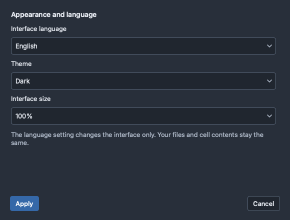
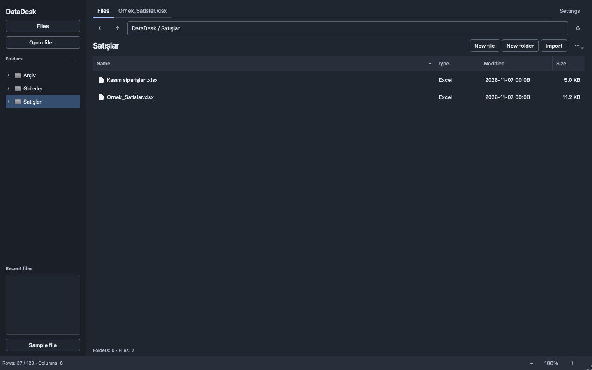
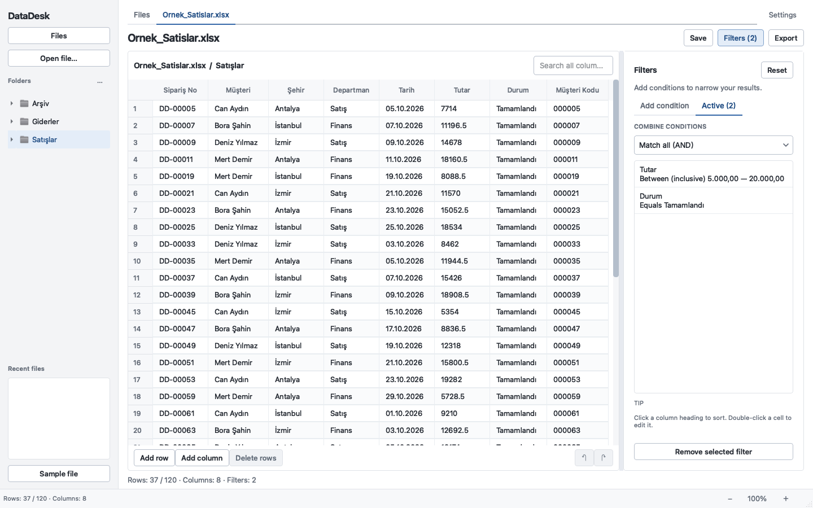

# DataDesk user guide

[Türkçe](KULLANIM.md) · [English](USAGE.en.md) · [Home](../README.en.md)

DataDesk 1.2.0 organizes local spreadsheet files and helps you edit, filter, and export their data. macOS and Windows use the same interface; shortcuts use **Cmd** on macOS and **Ctrl** on Windows. [Download a package](https://github.com/KrAlmano/DataDesk/releases/latest) and follow the [installation overview](../README.en.md#install). Python and Excel are not required.

## Choose your language and appearance

The initial interface is Turkish. Click **Ayarlar** in the top bar, choose **English**, and click **Uygula**. The same controls are then called **Settings** and **Apply**.

In **Settings**, choose **Light**, **Dark**, or **System**. System follows your operating system's current appearance, including changes while DataDesk is open. **Interface size** offers 75%, 100%, 125%, or 150%. Click **Apply** to use the choices immediately, or **Cancel** to discard them. Preferences are remembered after restarting.

Changing language translates controls and messages. It preserves file and folder names, column headings, cell contents, active filters, search, and edit history. The Turkish headings and values in this guide's sample table therefore remain Turkish in the English interface. Number-format choices are independent of the interface language.

Settings are available in both the **Files** and table views. Use `Cmd+,` / `Ctrl+,` to open them. The bottom bar's `−` and `＋` also change interface size; click the percentage to return to 100%.

## Organize your working folder

The app opens on **Files**. Your default folder is **Documents / DataDesk**; use **File → Change working folder** to select another location. DataDesk remembers the working folder and your last subfolder.

- Use **New folder** to create a folder, then double-click it or select it in the folder tree.
- Use the back and parent-folder buttons to navigate.
- Select an item and use **Rename** or **Move** from its context menu or the `⋯` menu. Moves stay within the working folder and do not overwrite an existing item.
- Use **Refresh** after adding files through Finder or File Explorer.

These are real folders and files. They remain accessible to Excel and your file manager after DataDesk closes.

## Create a table or add an existing file

Choose **New file**, enter a filename, select Excel `.xlsx`, CSV `.csv`, or TSV `.tsv`, and enter one column name per line. Names must be non-empty and unique. Open the resulting table, add rows, and save it. Existing files are never replaced by the new-file command.

**Import** copies existing files into the current folder, leaving the originals in place. If a filename already exists, a numbered copy is created. You can also drag supported files into the Files view. To work with a file without copying it into the workspace, use **Open file**. Supported inputs are `.xlsx`, `.xlsm`, `.xls`, `.csv`, and `.tsv`.

When the preview opens:

1. For Excel, choose the sheet and header row. If the header comes after two description rows, choose row `3`. Use **No header** when the first row contains data.
2. For CSV/TSV, check the delimiter and encoding. If text appears garbled, select the correct encoding manually, such as **Turkish Windows (1254)**.
3. Click **Refresh preview** after changing an option, then **Open file**.

Missing or duplicate column headings receive unique names. Opening a file does not rewrite it. **File → Open sample data** provides synthetic data for practice.

## Edit and save

Double-click a cell to edit it. Use **Add row**, **Add column**, and **Delete row** as needed. **Undo** and **Redo** retain the most recent 10 edit operations. Editing a filtered row changes its corresponding source record; clearing the filter does not undo the edit.

| Action | Result |
| --- | --- |
| **Save** | Saves the complete working table, including rows hidden by filters. |
| **Save as** | Writes the complete working table to a new Excel, CSV, or TSV file. |
| **Export** | Writes only the current filtered/search result, using selected columns and current sorting. |

Direct saving is for DataDesk-created files that have not changed externally. External/imported workbooks require a new filename, protecting their other sheets and workbook features. If another application changes a DataDesk-created file, save to a new destination.

To continue in Excel, save your changes and choose **File → Open in Excel / default application**. The command opens the file currently saved on disk.

## Filter, search, and sort

Click **Filters**. In **Add condition**, choose a column, operator, and value, then **Add filter**. Choose **Text**, **Number**, or **Date** explicitly when a column contains mixed values. Type choices affect comparisons without rewriting source cells.

The example screenshots use these conditions:

| Source column | Condition | Values |
| --- | --- | --- |
| `Tutar` | Between (inclusive) | `5.000,00` to `20.000,00`, using Turkish number format |
| `Durum` | Equals | `Tamamlandı` |

Under **Active**, **Match all (AND)** requires every condition, while **Match any (OR)** requires at least one. These two conditions together return 37 rows in the synthetic sample.

- Date ranges include the entire end date.
- **Turkish** interprets `1.234` as one thousand two hundred thirty-four; **English** interprets `1,234` the same way. **Automatic** treats a single dot or comma as a decimal separator. Choose an explicit format for ambiguous thousands separators.
- Empty/not-empty conditions do not require a value.
- Separate multiple matching values with semicolons, for example `İstanbul; Ankara` or `1,5; 2,5`.

The search field checks every column and further narrows the filtered result. Text matching is case-insensitive. Click a column heading to sort; numbers and dates use their data types. Remove a selected condition in **Active**, or use **Reset** to clear filters, search, and sorting without undoing cell edits.

## Export the result

1. Click **Export** and check the result row count.
2. Choose Excel `.xlsx`, CSV `.csv`, TSV `.tsv`, or Word `.docx`.
3. Uncheck unwanted columns and drag the remaining columns into the desired order.
4. For CSV, adjust delimiter and encoding if needed; defaults are semicolons and UTF-8 BOM.
5. Choose a destination different from the source workbook.

Export includes **all matching rows**, not only the rows visible on screen. An empty result still exports column headings.

**CSV formula protection** is enabled by default for CSV/TSV exports. It prefixes text that looks like a formula with an apostrophe, leaving numeric cells unchanged. Disable it if exact raw text is required. **Save / Save as** writes raw CSV/TSV text without this prefix. Excel may infer numbers, dates, or formulas when opening CSV, so prefer `.xlsx` for text IDs and leading zeroes.

## Smaller screens

On a narrow window, the folder sidebar hides while folder navigation remains available in **Files**. Filters open as a separate view; use **Back to table** to return to results. Wide windows show the table and filters side by side with an adjustable divider. Forms scroll when needed, while their final action buttons remain visible.

## Shortcuts

| Action | macOS | Windows |
| --- | --- | --- |
| New file | `Cmd+N` | `Ctrl+N` |
| New folder | `Cmd+Shift+N` | `Ctrl+Shift+N` |
| Open file | `Cmd+O` | `Ctrl+O` |
| Save | `Cmd+S` | `Ctrl+S` |
| Save as | `Cmd+Shift+S` | `Ctrl+Shift+S` |
| Export | `Cmd+Shift+E` | `Ctrl+Shift+E` |
| Search | `Cmd+F` | `Ctrl+F` |
| Show/hide filters | `Cmd+Shift+F` | `Ctrl+Shift+F` |
| Undo | `Cmd+Z` | `Ctrl+Z` |
| Settings | `Cmd+,` | `Ctrl+,` |
| Zoom in/out | `Cmd++` / `Cmd+−` | `Ctrl++` / `Ctrl+−` |
| Reset interface size | `Cmd+0` | `Ctrl+0` |

`F5` refreshes Files; `Alt+Left` goes back and `Alt+Up` opens the parent folder. Use `Tab` / `Shift+Tab` between controls. `Cmd/Ctrl+C` copies selected table rows with column headings.

## Workbook limits

DataDesk handles data tables. It does not calculate formulas; it reads results already saved in the workbook. Formulas without saved results appear as text with a warning. Recalculate and save in Excel or LibreOffice when current results are needed.

New tables and exports do not recreate the source workbook's macros, charts, images, merged cells, or original formatting. Use Excel to edit those features. Tables load into memory, so practical file size depends on your computer and format limits.
